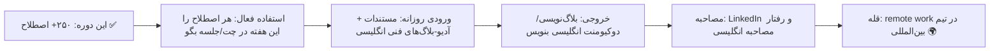

# فصل ۱۳ — چیت‌شیت جامع و نقشه راه

> 🎯 **هدف:** مرجع مرور سریع — چاپش کن، کنار مانیتورت بزن. هر فصل با ترتیب «صحنه».

---

## ۱۳.۱ — چرخه کدنویسی (فصل ۲)

| اصطلاح | معنی | | اصطلاح | معنی |
|---|---|---|---|---|
| feature | قابلیت | | edge case | حالت مرزی |
| bug / fix | باگ / رفع | | happy path | مسیر بدون خطا |
| issue | تیکت مسئله | | technical debt | بدهی فنی |
| reproduce | بازتولید خطا | | refactor | بازسازی کد |
| root cause | ریشه مشکل | | legacy | قدیمی/موروثی |
| workaround | راه‌حل موقتی | | spaghetti code | کد درهم |
| patch | وصله | | hardcoded | ثابت‌نویسی |
| MVP | کمینه قابل‌عرضه | | scalable | مقیاس‌پذیر |
| ship it | منتشر کن! | | robust | مقاوم |
| breaking change | تغییر شکست‌دهنده | | flaky | بی‌ثبات |
| deprecated | منسوخ | | smoke test | تست دود |
| out of scope | خارج از دامنه | | quick win | برنده سریع |
| scope creep | خزش دامنه | | low-hanging fruit | کار آسان پربازده |
| silver bullet | راه‌حل جادویی | | bikeshedding | بحث جزئیات |

## ۱۳.۲ — جلسه و Scrum (فصل ۳)

| اصطلاح | معنی | | اصطلاح | معنی |
|---|---|---|---|---|
| sprint | دوره کاری | | velocity | سرعت تیم |
| backlog | لیست کارها | | retro | جلسه بازنگری |
| user story | استوری کاری | | demo | نمایش کار |
| story points | واحد سختی | | refinement | آماده‌سازی استوری‌ها |
| standup | جلسه روزانه | | epic | مجموعه بزرگ |
| blocker / blocked on | مانع / قفل روی | | assignee | مسئول تیکت |
| WIP | در حال انجام | | sprint goal | هدف اسپرینت |
| touch base | هم‌حرفی سریع | | circle back | بعداً برمی‌گردیم |
| deep dive | بررسی عمیق | | action item | کار خروجی جلسه |
| take it offline | خارج از جلسه حل کن | | bandwidth | ظرفیت کاری |
| heads-up | خبر مقدماتی | | on my plate | بار کاری من |
| park it | بذاریم کنار | | sanity check | چک عقلانی |
| align | هم‌نظر شدن | | make the call | تصمیم نهایی |
| push back | رد کردن درخواست | | pick up / hand off | برداشتن/تحویل کار |

## ۱۳.۳ — Code Review و Git (فصل ۴-۵)

| اصطلاح | معنی | | اصطلاح | معنی |
|---|---|---|---|---|
| PR / MR | درخواست ادغام | | draft PR / WIP | ناتمام |
| approve | تأیید | | request changes | درخواست اصلاح |
| LGTM | Looks Good To Me | | nit | ایراد جزئی |
| blocking | مانع merge | | non-blocking | پیشنهادی |
| address feedback | رسیدگی به ریویو | | squash | له‌کردن کامیت‌ها |
| rebase on top of | ری‌بیس روی | | fast-forward | ادغام خطی |
| diverged | واگرا | | out of sync | ناهماهنگ |
| cherry-pick | برداشتن یک کامیت | | revert the merge | کامیت معکوس |
| detached HEAD | روی کامیت سرگردان | | dirty tree | تغییرات ذخیره‌نشده |
| stash | انبار موقت | | hotfix | فیکس اضطراری |
| green/red build | بیلد موفق/شکست | | break the build | بیلد را شکستن |
| upstream / fork | مخزن اصلی / کپی | | maintainer | نگهدارنده |
| good first issue | ایشوی آسان اول | | semver / changelog | نسخه‌گذاری / تاریخچه |

## ۱۳.۴ — ارور و دیباگ (فصل ۶)

| اصطلاح | معنی | | اصطلاح | معنی |
|---|---|---|---|---|
| stack trace | زنجیره خطا | | exception | استثنا |
| throw / catch | پرتاب/گرفتن | | fatal | مرگبار |
| timeout | اتمام مهلت | | memory leak | نشت حافظه |
| race condition | شرایط مسابقه | | deadlock | بن‌بست |
| segfault | خطای حافظه | | crash / freeze | سقوط / هنگ |
| silent failure | شکست بی‌صدا | | intermittent | متناوب |
| regression | بازگشت باگ | | mitigation | کاهش اثر |
| steps to reproduce | گام‌های بازتولید | | expected/actual | انتظار/واقعیت |
| repro rate | نرخ وقوع | | log level | سطح لاگ |
| tail the logs | دنبال زنده | | grep | جستجو |
| trace ID | شناسه ردیابی | | noise | لاگ بی‌ارزش |

## ۱۳.۵ — فرانت و UI (فصل ۷)

| اصطلاح | معنی | | اصطلاح | معنی |
|---|---|---|---|---|
| wireframe / mockup | طرح اولیه / نهایی‌نما | | prototype | نمونه تعاملی |
| design system / token | سیستم طراحی / متغیر | | pixel-perfect | مو‌به‌مو طرح |
| handoff / redlines | تحویل / مشخصات | | responsive | واکنش‌گرا |
| breakpoint / viewport | نقطه شکست / ناحیه دید | | above the fold | بالای اسکرول |
| modal / toast / tooltip | پنجره/اعلان/راهنما | | dropdown / toggle | بازشو / کلید |
| skeleton / spinner | اسکلت / چرخان | | CTA | دکمه اقدام |
| empty state | حالت خالی | | onboarding | آشناسازی |
| lazy loading | بارگذاری تنبل | | layout shift | پرش چیدمان |
| debounce | تأخیردهی | | a11y | دسترس‌پذیری |
| mobile-first | موبایل‌محور | | cross-browser | همه مرورگرها |

## ۱۳.۶ — بک‌اند و دواپس (فصل ۸-۹)

| اصطلاح | معنی | | اصطلاح | معنی |
|---|---|---|---|---|
| endpoint / payload | آدرس API / بدنه داده | | CRUD | ساخت/خواندن/ویرایش/حذف |
| AuthN / AuthZ | هویت / مجوز | | rate limit / throttle | سقف / کندسازی |
| webhook / polling | خبررسان / پرس‌وجوی دوره‌ای | | idempotent | تکراربی‌ضرر |
| backward compatible | سازگار با قبل | | schema / migration | ساختار / تغییر آن |
| seed / index | داده اولیه / نمایه | | transaction | بسته همه‌یا‌هیچ |
| constraint | قید | | soft delete | حذف منطقی |
| audit log | لاگ ممیزی | | retry with backoff | تلاش با فاصله |
| queue / cron | صف / کار زمان‌دار | | health check | بررسی سلامت |
| staging / QA / prod | محیط‌ها | | canary | نسخه آزمایشی |
| deploy / roll back | استقرار / بازگشت | | downtime / uptime | خرابی / در دسترس |
| SLA | توافق سطح سرویس | | feature flag | کلید قابلیت |
| incident / outage | حادثه / قطعی | | on-call / page | نوبت‌داری / هشدار |
| sev1 | حادثه بحرانی | | postmortem | گزارش حادثه |
| blameless | بی‌سرزنش | | SPOF | نقطه خرابی واحد |
| CI / CD | یکپارچه‌سازی/تحویل مداوم | | artifact | خروجی بیلد |
| p95 | صدک ۹۵ تاخیر | | observability | مشاهده‌پذیری |

## ۱۳.۷ — معماری و چت و شغل (فصل ۱۰-۱۲)

| اصطلاح | معنی | | اصطلاح | معنی |
|---|---|---|---|---|
| monolith / microservices | مونولیت / مایکروسرویس | | decouple / coupled | جداسازی / وابستگی |
| trade-off | معاوضه | | over-engineering | مهندسی بیش از حد |
| SOLID / DRY / KISS / YAGNI | اصول طراحی | | SoC | جداسازی دغدغه‌ها |
| design pattern / anti-pattern | الگو / ضدالگو | | god object | شیء خدا |
| abstraction / leaky | انتزاع / سوراخ | | boilerplate | کد تشریفاتی |
| code smell | بوِ کد | | magic number | عدد جادویی |
| POC / spike | اثبات ایده / بررسی سریع | | RFC / spec | سند طراحی |
| greenfield / brownfield | از صفر / روی موجود | | vendor lock-in | قفل فروشنده |
| FYI / ASAP / ETA / TL;DR | اطلاع / فوری / زمان / خلاصه | | BTW / IMO / EOD | راستی / به‌نظرم / آخر روز |
| POC / TBD / N/A | نمونه / نامشخص / بی‌ربط | | e.g. / i.e. | مثلاً / یعنی |
| I'm on it | درگیرشم | | Keep me posted | در جریان بذار |
| Good catch | نکته خوبی بود | | My bad | تقصیر من |
| JD / YoE | شرح شغل / سال سابقه | | must-have / nice-to-have | الزامی / امتیازی |
| screening / take-home | غربال / پروژه خانه | | STAR | قالب جواب رفتاری |
| offer / negotiate | پیشنهاد / مذاکره | | notice period | دوره اطلاع قبلی |
| probation | دوره آزمایشی | | onboarding | ورود به شرکت |

## ۱۳.۸ — نقشه راه: بعد از این دوره چه کنم؟

**سه توصیه پایانی:**

1. **قانون «۳ بار»:** هر اصطلاح جدید را سه بار در بافت واقعی استفاده کن (چت، کامنت PR، جلسه) — بعد از حافظه‌ات نمی‌رود. یادگیری واژه = مصرف واژه.
2. **یک دفترچه اصطلاح شخصی بساز** (Notion/فایل): هر بار اصطلاح ناشناسی دیدی — بنویس، تلفظش، جمله‌ای که در آن دیدی. بعد از ۳ ماه، دیکشنری شخصی‌ات از هر دوره‌ای قوی‌تر است.
3. **داکیومنت‌های انگلیسی را با صدای بلند بخوان** — تلفظ با خواندن ساخته می‌شود؛ و تلفظ درست اعتماد تیم را می‌سازد (جدول فصل ۱ را هر ماه یک‌بار مرور کن).

**پایان دوره:** تو حالا ۲۵۰+ اصطلاح صحنه‌های واقعی را می‌شناسی — از standup تا postmortem، از PR تا offer. ترس از «انگلیسی جلسه» جای خودش را به لحن مطمئن داده. دنیای بین‌المللی توسعه نرم‌افزار، منتظر توست! 🌍🚀
